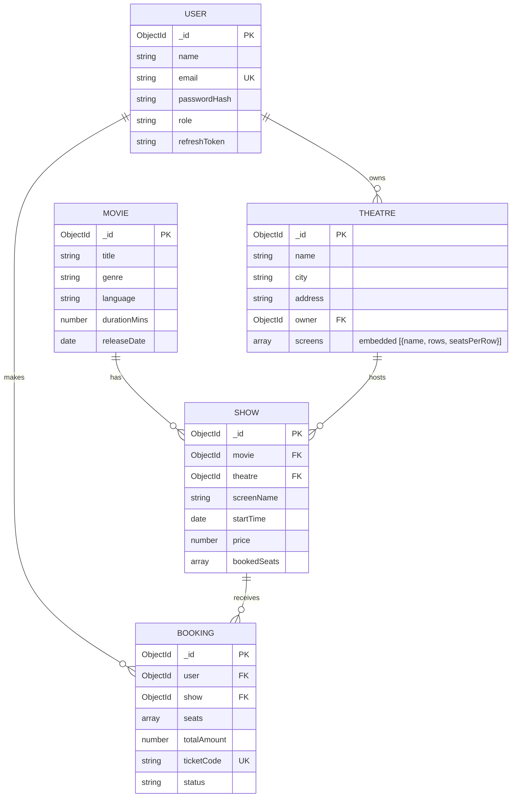

# MovieTime – Cinema Ticket Booking

A full-stack MERN capstone project for browsing movies, selecting seats on a live interactive seat map with real-time Socket.IO seat locking, booking tickets atomically, and viewing role-based revenue reports.

---

## Features by Role

- **User (`user`)**:
  - Register, login, refresh session, and logout.
  - Browse movies with title search and genre filter.
  - View movie details and available shows with theatre and screen info.
  - Select up to 6 seats on a live seat map (Socket.IO locking with 2-minute auto-expiry).
  - Confirm bookings with unique generated ticket codes, view booking history, and cancel future confirmed bookings.
- **Theatre Admin (`theatreAdmin`)**:
  - View owned theatres and their screens (`/my`).
  - Schedule, update, and delete shows for owned theatres.
  - View movie and show collection reports (total bookings, seats sold, revenue) scoped to owned theatres.
- **Super Admin (`superAdmin`)**:
  - Create, update, and delete movies.
  - Create and delete theatres (assigning a `theatreAdmin` owner at creation).
  - Manage shows and view global movie and show collection reports.

---

## Tech Stack

- **Backend**: `express`, `mongoose`, `dotenv`, `bcrypt`, `jsonwebtoken`, `socket.io`, Node core `crypto` (`nodemon` for dev, `socket.io-client` dev-only for `socketTest.js`).
- **Frontend**: `react`, `react-dom`, `react-router-dom`, `socket.io-client`, Fetch API, React Context API, plain CSS, Vite (with dev proxy for `/api` and `/socket.io`).

---

## Setup Steps (Windows)

### Prerequisites
- Node.js (v18+ recommended)
- MongoDB running locally on `127.0.0.1:27017` (or a MongoDB Atlas connection string)

### 1. Backend Setup
```powershell
cd backend
npm install
copy .env.example .env
```
Edit `backend\.env` if you are using MongoDB Atlas or custom JWT secrets.

Seed sample users, movies, a theatre, and shows:
```powershell
npm run seed
```
Start the backend server:
```powershell
npm run dev
```

### 2. Frontend Setup
In a second terminal:
```powershell
cd frontend
npm install
npm run dev
```
Open `http://localhost:5173` in your browser.

### Seeded Accounts
| Role | Email | Password |
| :--- | :--- | :--- |
| `superAdmin` | `admin@movietime.com` | `admin123` |
| `theatreAdmin` | `theatre@movietime.com` | `theatre123` |
| `theatreAdmin` | `theatre2@movietime.com` | `theatre123` |
| `user` | `user@movietime.com` | `user123` |

---

## Environment Variables (`backend/.env.example`)

| Name | Purpose | Example |
| :--- | :--- | :--- |
| `PORT` | Port where Express & Socket.IO listen | `5000` |
| `MONGO_URI` | MongoDB connection string | `mongodb://127.0.0.1:27017/movietime` |
| `JWT_ACCESS_SECRET` | Secret key for signing 15m access tokens | `your_access_secret_here` |
| `JWT_REFRESH_SECRET` | Secret key for signing 7d refresh tokens | `your_refresh_secret_here` |
| `JWT_ACCESS_EXPIRES_IN` | Access token lifetime | `15m` |
| `JWT_REFRESH_EXPIRES_IN` | Refresh token lifetime | `7d` |
| `CLIENT_ORIGIN` | Allowed frontend origin for CORS (optional locally) | `http://localhost:5173` |

### Frontend (`frontend/.env.example`)
| Name | Purpose | Example |
| :--- | :--- | :--- |
| `VITE_API_URL` | Backend base URL in production (leave empty locally for Vite proxy) | `https://movietime-api.onrender.com` |

---

## Folder Structure

```text
movietime-cinema-ticket-booking/
├── .gitignore
├── README.md
├── VIVA_NOTES.md
├── postman_collection.json
├── backend/
│   ├── .env.example
│   ├── package.json
│   ├── server.js
│   ├── config/db.js
│   ├── models/ (User.js, Movie.js, Theatre.js, Show.js, Booking.js)
│   ├── middleware/ (authMiddleware.js, roleMiddleware.js, errorMiddleware.js)
│   ├── controllers/ (auth, movie, theatre, show, booking, report)
│   ├── routes/ (auth, movie, theatre, show, booking, report)
│   ├── sockets/ (seatLocks.js, seatLockSocket.js)
│   ├── utils/seatUtils.js
│   └── scripts/ (seed.js, socketTest.js, auditTest.js)
└── frontend/
    ├── .env.example
    ├── package.json
    ├── vite.config.js
    ├── index.html
    └── src/
        ├── App.jsx, main.jsx, index.css
        ├── context/AuthContext.jsx
        ├── services/ (api.js, socket.js)
        ├── components/ (Navbar.jsx, ProtectedRoute.jsx, RoleRoute.jsx, SeatGrid.jsx)
        └── pages/ (Home, MovieDetail, SeatSelection, MyBookings, Login, Register, AdminDashboard)
```

---

## REST API Documentation

### Health
| Method | URL | Access | Request Body | Description |
| :--- | :--- | :--- | :--- | :--- |
| `GET` | `/api/health` | Public | — | Check if backend is running |

### Auth (`/api/auth`)
| Method | URL | Access | Request Body | Description |
| :--- | :--- | :--- | :--- | :--- |
| `POST` | `/api/auth/register` | Public | `{ name, email, password }` | Register a new `user` and return tokens |
| `POST` | `/api/auth/login` | Public | `{ email, password }` | Login and return access + refresh tokens |
| `POST` | `/api/auth/refresh` | Public | `{ refreshToken }` | Issue a new access token |
| `POST` | `/api/auth/logout` | Auth | — | Clear stored refresh token |
| `GET` | `/api/auth/me` | Auth | — | Get current logged-in user profile |
| `GET` | `/api/auth/theatre-admins` | `superAdmin` | — | List all `theatreAdmin` users |

### Movies (`/api/movies`)
| Method | URL | Access | Request Body | Description |
| :--- | :--- | :--- | :--- | :--- |
| `GET` | `/api/movies` | Public | — | List movies (`?search=` & `?genre=`) |
| `GET` | `/api/movies/:id` | Public | — | Get movie details and its shows |
| `POST` | `/api/movies` | `superAdmin` | `{ title, description, genre, language, durationMins, posterUrl, releaseDate }` | Create a movie |
| `PUT` | `/api/movies/:id` | `superAdmin` | Movie fields to update | Update a movie |
| `DELETE` | `/api/movies/:id` | `superAdmin` | — | Delete a movie |

### Theatres (`/api/theatres`)
| Method | URL | Access | Request Body | Description |
| :--- | :--- | :--- | :--- | :--- |
| `GET` | `/api/theatres` | Public | — | List all theatres |
| `GET` | `/api/theatres/my` | `theatreAdmin`, `superAdmin` | — | List theatres owned by logged-in admin |
| `GET` | `/api/theatres/:id` | Public | — | Get theatre details |
| `POST` | `/api/theatres` | `superAdmin` | `{ name, city, address, owner, screens }` | Create theatre with assigned owner |
| `PUT` | `/api/theatres/:id` | `superAdmin`, owning `theatreAdmin` | `{ name, city, address, screens }` | Update theatre or screens |
| `DELETE` | `/api/theatres/:id` | `superAdmin` | — | Delete a theatre |

### Shows (`/api/shows`)
| Method | URL | Access | Request Body | Description |
| :--- | :--- | :--- | :--- | :--- |
| `GET` | `/api/shows` | Public | — | List shows (`?movie=` & `?theatre=`) |
| `GET` | `/api/shows/:id` | Public | — | Get show details + screen layout |
| `POST` | `/api/shows` | `superAdmin`, owning `theatreAdmin` | `{ movie, theatre, screenName, startTime, price }` | Schedule a show |
| `PUT` | `/api/shows/:id` | `superAdmin`, owning `theatreAdmin` | `{ screenName, startTime, price }` | Update a show |
| `DELETE` | `/api/shows/:id` | `superAdmin`, owning `theatreAdmin` | — | Delete a show |

### Bookings (`/api/bookings`)
| Method | URL | Access | Request Body | Description |
| :--- | :--- | :--- | :--- | :--- |
| `POST` | `/api/bookings` | Auth | `{ showId, seats }` | Atomically book seats and generate `ticketCode` |
| `GET` | `/api/bookings/my` | Auth | — | List logged-in user's bookings (newest first) |
| `GET` | `/api/bookings/:id` | Owner or `superAdmin` | — | Get single booking details |
| `PATCH` | `/api/bookings/:id/cancel` | Owner | — | Cancel future confirmed booking and free seats |

### Reports (`/api/reports`)
| Method | URL | Access | Request Body | Description |
| :--- | :--- | :--- | :--- | :--- |
| `GET` | `/api/reports/movies` | `superAdmin`, `theatreAdmin` | — | Confirmed bookings, seats sold & revenue per movie |
| `GET` | `/api/reports/shows` | `superAdmin`, `theatreAdmin` | — | Confirmed bookings, seats sold & revenue per show |

---

## Socket.IO Documentation

- **Handshake Auth**: Client connects with `io({ auth: { token: accessToken } })`. Server verifies the JWT with `JWT_ACCESS_SECRET` and sets `socket.user = { id, role }`.
- **Rooms**: `show:<showId>`

| Direction | Event | Payload | Description |
| :--- | :--- | :--- | :--- |
| Client → Server | `join-show` | `{ showId }` | Join the show room |
| Client → Server | `leave-show` | `{ showId }` | Leave room and release user's locks for that show |
| Client → Server | `lock-seat` | `{ showId, seat }` | Request a 2-minute lock on a seat |
| Client → Server | `unlock-seat` | `{ showId, seat }` | Release user's own lock on a seat |
| Server → Client | `current-locks` | `{ showId, locks }` | Sent on `join-show` with `{ [seat]: userId }` |
| Server → Client | `lock-error` | `{ message }` | Sent to requester on invalid/locked/booked seat or >6 limit |
| Server → Room | `seats-locked` | `{ showId, seats, userId }` | Broadcast when a seat is locked |
| Server → Room | `seats-unlocked` | `{ showId, seats }` | Broadcast on unlock, disconnect, 2m expiry, or booking cancel |
| Server → Room | `seats-booked` | `{ showId, seats }` | Broadcast when `POST /api/bookings` succeeds |

---

## ER Diagram



---

## How Seat Locking Prevents Double Booking (2 Layers)

1. **Layer 1 — In-Memory Live Lock (`sockets/seatLocks.js`)**: When User A clicks a seat, Socket.IO stores `{ userId, timer }` in memory for 2 minutes and broadcasts `seats-locked` so User B sees it turn yellow immediately and cannot select it.
2. **Layer 2 — Atomic MongoDB Update (`bookingController.js`)**: Even if two users send `POST /api/bookings` at the exact same millisecond, `Show.findOneAndUpdate({ _id: showId, bookedSeats: { $nin: seats } }, { $push: { bookedSeats: { $each: seats } } })` executes atomically in MongoDB—only one request succeeds and the other gets `null` and returns `409 Conflict`.

---

## Postman Instructions

1. Open Postman and click **Import** → select `postman_collection.json`.
2. Make sure the backend is running (`cd backend; npm run dev`) and seeded (`npm run seed`).
3. Run **Auth → Login (User)** or **Auth → Login (SuperAdmin)** — the Tests script automatically saves `accessToken` and `refreshToken` into collection variables.
4. Run requests in order (Movies, Theatres, Shows, Bookings, Reports); create requests automatically save `movieId`, `theatreId`, `showId`, and `bookingId` for subsequent requests.

---

## Deployment Guide

1. **Database (MongoDB Atlas)**:
   - Create a free M0 cluster on MongoDB Atlas, create a database user, allow network access (`0.0.0.0/0`), and copy the connection string for `MONGO_URI`.
2. **Backend (Render)**:
   - Create a **Web Service** pointing to the `backend` root directory.
   - Build command: `npm install` | Start command: `npm start`.
   - Set environment variables: `MONGO_URI`, `JWT_ACCESS_SECRET`, `JWT_REFRESH_SECRET`, `JWT_ACCESS_EXPIRES_IN=15m`, `JWT_REFRESH_EXPIRES_IN=7d`, and `CLIENT_ORIGIN=https://your-frontend.vercel.app`.
   - **Important note**: Render's free plan sleeps after inactivity, and because Socket.IO seat locks are stored in memory (`seatLocks` Map), any active temporary locks reset if the server restarts or sleeps (confirmed bookings remain safe in MongoDB).
3. **Frontend (Vercel or Netlify)**:
   - Create a project pointing to the `frontend` root directory.
   - Build command: `npm run build` | Output directory: `dist`.
   - Set environment variable: `VITE_API_URL=https://your-backend.onrender.com`.
